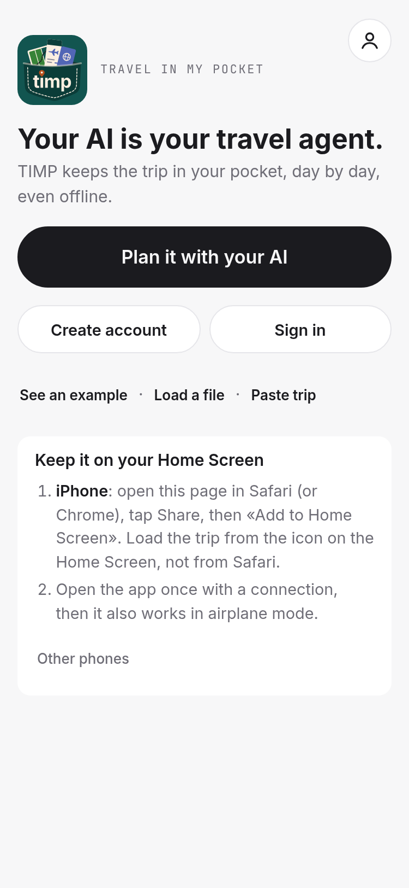
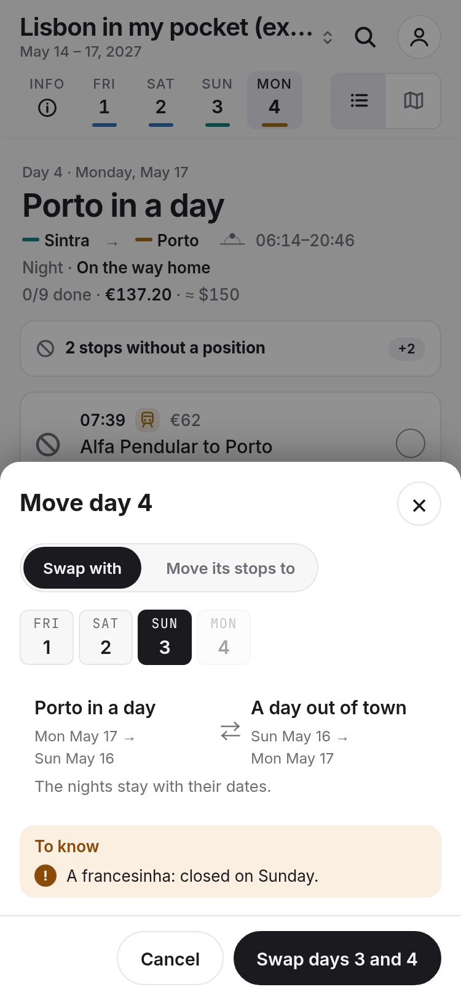
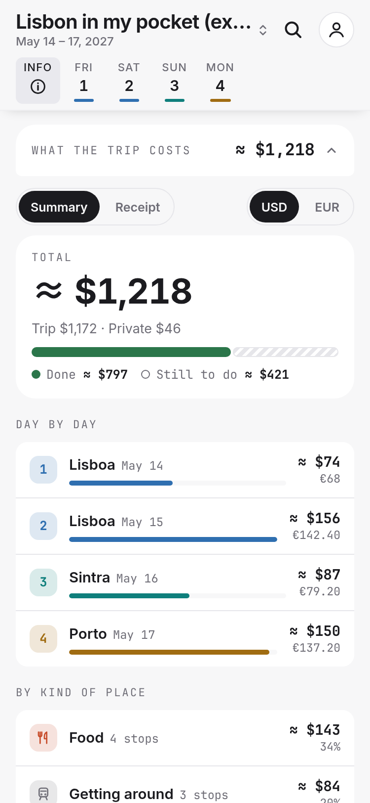

# TIMP · Travel in my pocket

[](https://github.com/Frafal/TIMP/actions/workflows/deploy.yml)
[](LICENSE)

**Your AI is your travel agent. TIMP keeps the trip in your pocket.**

Tell Claude, ChatGPT or Gemini where and when: it plans the trip. TIMP shows it on your
phone day by day, with maps and costs, even offline, and your AI changes it while you
travel.

**Open the app: <https://frafal.github.io/TIMP/>**

<p align="center">
  
  
  
  
</p>

<p align="center">
  
  
  
  
</p>

## What it does

- **Planned with your AI**: any chat writes the trip from [llms.txt](llms.txt); linked to
  your account, it puts the trip on your phones and changes it when you ask.
- **Every day at a glance**: times or parts of the day, a short note on each stop, the
  weather, alternatives for a meal or a rainy day. Tick what you did, skip what you leave.
- **A map for every day**: interactive online (OpenStreetMap or Google Maps), a sketch to
  scale offline, Directions one tap away.
- **Change it on the way**: add a stop by its name or a Google Maps link, move stops and
  whole days; TIMP says first what to know there (closed that day, already booked).
- **What it costs**, in your currency at each day's rate, with expenses only you see.
- **Versions, like Git**: every change is one, History brings any back, copies changed
  apart are joined.
- **With an account** (optional, by invitation): your trips on every phone, shared with
  whoever travels with you, published as a page, locked when final.

iPhone and Android from the Home Screen, no app store. English and Italian, light and dark.

## Start

Open the app and add it to the Home Screen (it shows your phone's steps). Open it from the
icon and tap **Plan it with your AI**, or **See an example** first. Open it once with a
connection before you leave: then it works in airplane mode. More:
[Using the app](docs/using-the-app.md).

## Link your AI

With an account, a linked chat works on your trips itself: "plan four days in Lisbon in May
for two", then, on the way, "add a dinner near the hotel on day 2".

1. In TIMP, **You** → **Your AI**: choose your app and copy the address.
2. Add it as a connector: in **Claude**, Settings → Connectors → Add custom connector; in
   **ChatGPT**, Settings → Apps & Connectors, with developer mode on → Create.
3. Allow it in TIMP with your passkey.

Taking anything away always asks you first. It never touches a locked trip, your private
expenses (unless you allow them) or your account. History marks what it did; **Unlink**
stops it at once.

## Write a trip without the app

> **AI assistant reading this page:** before writing a trip, read [llms.txt](llms.txt):
> the format, the method and a complete example, in one page.

- **Any chat**: TIMP has the message ready (**Plan it with your AI**); paste the answer
  back with **Paste trip**. The message, to write by hand:

  ```text
  Read https://github.com/Frafal/TIMP/blob/main/llms.txt and follow it exactly: write a
  TIMP trip file, and give me the whole JSON in one block.
  My trip: [where, dates or number of days, who travels, what you like, how you get around].
  ```
- **A coding agent** (Claude Code, Codex, Cursor…) in this repository follows
  [AGENTS.md](AGENTS.md) and writes the file into `private/`, which Git ignores.
- **By hand**: start from [examples/demo-trip.json](examples/demo-trip.json);
  `node tools/validate-trip.mjs --map my-trip.json` points at every mistake.

How to write a good one: [docs/creating-a-trip.md](docs/creating-a-trip.md). Every field:
[docs/trip-format.md](docs/trip-format.md), also as a
[JSON Schema](https://frafal.github.io/TIMP/trip.schema.json). Never commit a real trip:
it has your hotels and your dates.

## Privacy

- Without an account, the trip stays on your phone. Only what a feature needs goes out (a
  place to find, the month of an exchange rate); the map services see the area you look at.
- No analytics, no cookies, no third-party scripts at startup.
- With an account, trips go to its service encrypted, only to the people and chats you
  allow. Export or delete everything whenever you want.

In detail: the [privacy policy](docs/privacy.md) ([in italiano](docs/privacy.it.md)) and the
[terms of use](docs/terms.md) of the service. Your data: privacy@usetimp.com; anything
else: hello@usetimp.com.

## Google Maps, your own copy, development

- **Google Maps** (optional): a key in the trip file gives everyone Google's map. One that
  cannot cost anything: [docs/google-maps.md](docs/google-maps.md).
- **Your own copy**: static files, any HTTPS host. On GitHub Pages: fork, set Settings →
  Pages → Source to GitHub Actions, run "Deploy". Elsewhere: `node tools/build.mjs --repo
  https://github.com/<you>/<repository>` and upload `dist/`.
- **Develop**: nothing to install. Serve the folder (`python3 -m http.server 4173`); Node
  22 or later runs `npm run check`, `npm test` and `npm run e2e`. The rules for a change:
  [CONTRIBUTING.md](CONTRIBUTING.md). Ideas, bug reports and pull requests are welcome;
  never attach a real trip file, issues are public. Thanks to everyone who
  [contributed](https://github.com/Frafal/TIMP/graphs/contributors).

## License

[MIT](LICENSE) © 2026 Francesco Falqui. MapLibre is under its own
[BSD 3-Clause license](vendor/maplibre/LICENSE). Map data © OpenStreetMap contributors,
vector tiles © OpenMapTiles, served by OpenFreeMap.
